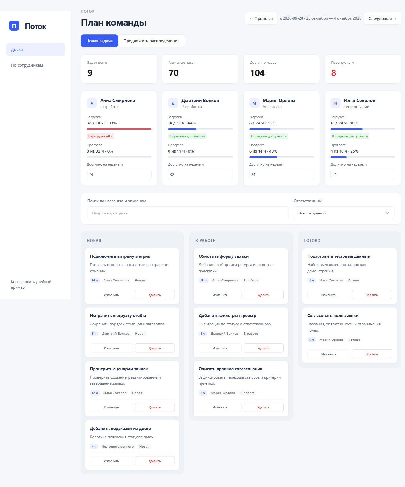
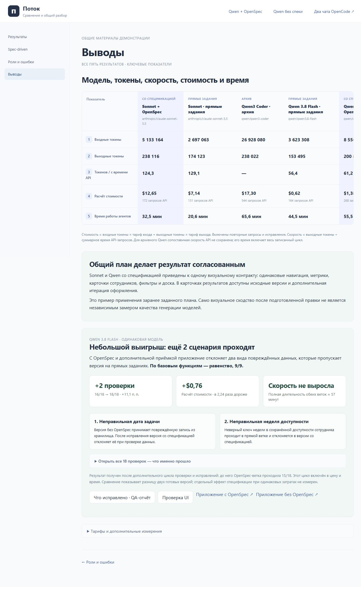

# OpenCode Agent Lab · материалы для ВТБ

**[Открыть PDF-гайд: схемы передачи заданий, spec-driven и пошаговая инструкция OpenCode](docs/pdf/OpenCode-Guide-with-Workflows.pdf)**

**[Настройка API и моделей со скриншотами: куда нажать, вставить ключ и выбрать роль](docs/pdf/OpenCode-API-Setup-Annotated.pdf)** — отдельный короткий PDF с обведёнными кнопками и пустым полем ключа.

Комплект после демонстрации: пять реализаций Task Tracker, исходные требования, конфигурации ролей, сохранённые ответы, 116 чекпоинтов и измеренные метрики. Можно открыть приложения, изучить код каждой итерации и повторить путь разработки.

| № | Прогон | Подход | Результат и история |
|---|---|---|---|
| 1 | Sonnet 5.5 + OpenSpec | Со спецификацией | `sdd-05…sdd-19`, общая UI-версия `sdd-ui-20` |
| 2 | Sonnet 5.5 | Прямые задания | `direct-03…direct-15` |
| 3 | Qwen3 Coder 480B A35B | Прямые задания | `qwen-00…qwen-15` |
| 4 | Qwen 3.8 Flash | Прямые задания | `flash-02…flash-13` |
| 5 | Qwen 3.8 Flash + OpenSpec | Со спецификацией | `qspec-00…qspec-11`, общая UI-версия `qspec-ui-12` |

В стартовом экране доступны все пять приложений и их этапы. Для совместного просмотра в двух чатах по умолчанию выбраны Qwen со спецификацией и Qwen с прямыми заданиями. Запись воспроизводится локально без вызова API.

**Перенос на другой ноутбук:** [инструкция установки](docs/LAPTOP-SETUP.md). **Передать другому агенту:** [AGENTS.md](AGENTS.md) и [готовый текст задачи](docs/AGENT-HANDOFF.md).



## Быстрый запуск

Проверенная конфигурация: Windows 10/11 и Node.js 22.14+ или 24 LTS. Предварительно установленный OpenCode не требуется: нужная версия устанавливается автоматически.

Без Git: **Code → Download ZIP**, распакуйте архив, установите Node.js, затем дважды нажмите `INSTALL-WINDOWS.cmd`. После установки запускайте `START-WINDOWS.cmd`.

```powershell
git clone https://github.com/jabrailkhalil/opencode-agent-lab.git
cd opencode-agent-lab
.\INSTALL-WINDOWS.cmd
.\START-WINDOWS.cmd
```

Скрипт проверит файлы, создаст чистые рабочие папки, запустит локальный OpenCode и откроет четыре вкладки:

1. главная страница: PDF, пять реализаций, метрики и переходы к этапам;
2. пульт Qwen со спецификацией;
3. пульт Qwen с прямыми заданиями;
4. два чата OpenCode рядом.

Первый запуск загружает OpenCode из npm и может занять несколько минут. Последующие запуски используют локальную установку.

Материалы: [памятка по кликам](docs/CLICK-GUIDE.md), [PDF](docs/pdf/README.md), [все эксперименты](docs/EXPERIMENTS.md), [чекпоинты](docs/ARCHITECTURE.md), [новый API-прогон](docs/LIVE-API.md).

## Как передаются задания между ролями

Ведущий выбирает роль для каждого обращения и передаёт ей готовые документы либо новые наблюдения. Стрелки показывают очередность заданий, а не самостоятельные вызовы агентов. На каждой схеме указаны вход, задача и сохранённый результат; порядок Sonnet и Qwen различается.

- [Spec-driven: спецификация, валидация документа и обратная связь](ui/agent-flow-spec.svg).
- [Qwen + OpenSpec: 11 обращений](ui/agent-flow-qwen-spec.svg), [Qwen без OpenSpec: 11 обращений](ui/agent-flow-qwen-direct.svg).
- [Sonnet + OpenSpec: 14 обращений](ui/agent-flow-sonnet-spec.svg), [Sonnet без OpenSpec: 12 обращений](ui/agent-flow-sonnet-direct.svg).

Точный маршрут, файлы и пояснение отличий: [WORKFLOWS.md](docs/WORKFLOWS.md). Эти же схемы находятся в пультах в разделе «Модель и роли», в общем разделе Spec-driven и в начале PDF. Дополнительная подготовленная UI-итерация отделена от исходных API-обращений.

## Что находится в репозитории

```text
checkpoints/   снимки кода, документов, отчётов и интерфейса
data/          порядок этапов, ответы и измеренные метрики
templates/     четыре чистых проекта с ролями OpenCode
experiments/   протоколы, токены, запросы и связь со снимками кода
tools/         локальный сервер, восстановление и проверка
ui/            пульт, два чата и сравнение результатов
```

В каждой команде настроены роли Analyst, Designer, Developer и Tester. Для каждой роли ограничены доступные пути, команды и число шагов. Следующий участник получает результат предыдущего через файлы: требования → анализ → дизайн → код → проверка.

## Проверка целостности

```powershell
npm run check
npm test
```

`npm run check` сверяет SHA-256 всех экспортированных файлов чекпоинтов, наличие ролей и отсутствие ключей и локальных путей. Переход к чекпоинту сначала проверяет сохранённый снимок, затем восстанавливает файлы рабочей папки. Текущая версия перед заменой сохраняется в `.runtime`.

Остановить локальные процессы после показа: `npm stop`.

## Новый запуск моделей

Запись не требует API-ключа. Для нового эксперимента создайте отдельный проект:

```powershell
npm run api:project -- qwen-spec
```

Откройте напечатанную папку в OpenCode и подключите собственного провайдера через его интерфейс. Ключи не нужно писать в `opencode.json` или коммитить. Подробности и варианты проекта описаны в [docs/LIVE-API.md](docs/LIVE-API.md).

## Ограничения данных

Это один сохранённый опыт на каждый вариант, поэтому цифры не доказывают универсальное превосходство модели или методологии. OpenSpec дал два дополнительных подтверждённых сценария обработки ошибочных данных, но потребовал больше токенов и времени. Проверка спецификации, тесты логики и браузерная приёмка в интерфейсе разделены.



Две spec-ветки также включают отдельную дополнительную итерацию оформления по общему плану. Оригинальные API-результаты остаются доступны. Это позволяет показать, как заранее заданный визуальный контракт согласует интерфейсы разных моделей, сохраняя историю разработки.

## English

Workshop handout with five recorded Task Tracker experiments, verified checkpoints and reusable OpenCode configurations. The tested launcher targets Windows 10/11. Use INSTALL-WINDOWS.cmd once, then START-WINDOWS.cmd. API keys are unnecessary for replay. Laptop setup and agent handoff instructions are linked above.

MIT. Third-party licenses are listed in [THIRD_PARTY_NOTICES.md](THIRD_PARTY_NOTICES.md).

