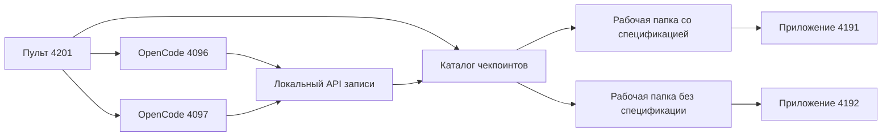

# Архитектура воспроизведения

`START-WINDOWS.cmd` устанавливает зависимости, проверяет экспорт и запускает семь локальных портов. `tools/reset.mjs` копирует чистые шаблоны в `.runtime/workspaces`. OpenCode работает с обычными ролями и разрешениями, но его провайдер направлен на локальный endpoint `/v1/chat/completions`.

Сервер записи проверяет текущую ветку, ожидаемую роль и текст задания. После успешной проверки он восстанавливает следующий снимок и возвращает сохранённый ответ в формате OpenAI-compatible API. Это позволяет показывать реальный интерфейс OpenCode без ожидания и расходов.

Общий сброс `/api/replay/reset` сначала проверяет, что агенты не работают и оба снимка целы, затем создаёт новые сессии и связывает каждую с текущей веткой. У прогона есть общий epoch, у этапа — version и sessionId. Пульт получает эту же запись через `/api/cursor`, а помощник OpenCode — через `/__demo/next`. Последняя сессия из произвольной истории больше не выбирается.

Явная подстановка создаёт одноразовое разрешение для точных sessionId, version, роли, модели и текста. Прокси 4216/4217 принимает отправку только с этим разрешением; локальный провайдер расходует его один раз. Повторный запрос, старый чат, изменённый промпт и запрос без подготовки не меняют этап. Повтор API-ответа внутри той же сессии возвращает сохранённый ответ без повторного восстановления снимка.

Общая кнопка отправки хранит только чаты, подготовленные текущим действием в этом окне. Она не собирает все найденные черновики. Смена «Оба / Только слева / Только справа» сбрасывает подготовку общей отправки. Перезагрузка страницы также требует новой явной подготовки; автоматической отправки нет. Восстановление отдельного этапа создаёт новый пустой чат этой ветки и не меняет другую.

Если общий сброс прервался, отправка блокируется с видимой ошибкой до успешного повторного сброса. Старые файлы сохраняются в резервной папке. Произвольный промпт относится к отдельному живому API-проекту, а не к воспроизведению чекпоинтов.

Каталог `checkpoints/` является неизменяемым источником. Перед восстановлением проверяются размер и SHA-256 каждого файла. Живые файлы лежат только в `.runtime/`, которая исключена из Git.

Сравнение использует четыре современных прогона из `data/workshop.json` и один архивный прогон из `data/legacy-qwen.json`. Стоимость пересчитана по полному входу и выходу без скидки кэша. Время — записанное время работы агентов, а не длительность презентации.

