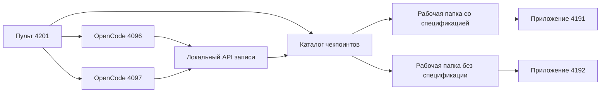

# Архитектура воспроизведения

`START-WINDOWS.cmd` устанавливает зависимости, проверяет экспорт и запускает семь локальных портов. `tools/reset.mjs` копирует чистые шаблоны в `.runtime/workspaces`. OpenCode работает с обычными ролями и разрешениями, но его провайдер направлен на локальный endpoint `/v1/chat/completions`.

Сервер записи проверяет текущую ветку, ожидаемую роль и текст задания. После успешной проверки он восстанавливает следующий снимок и возвращает сохранённый ответ в формате OpenAI-compatible API. Это позволяет показывать реальный интерфейс OpenCode без ожидания и расходов.

Каталог `checkpoints/` является неизменяемым источником. Перед восстановлением проверяются размер и SHA-256 каждого файла. Живые файлы лежат только в `.runtime/`, которая исключена из Git.

Сравнение использует четыре современных прогона из `data/workshop.json` и один архивный прогон из `data/legacy-qwen.json`. Стоимость пересчитана по полному входу и выходу без скидки кэша. Время — записанное время работы агентов, а не длительность презентации.

