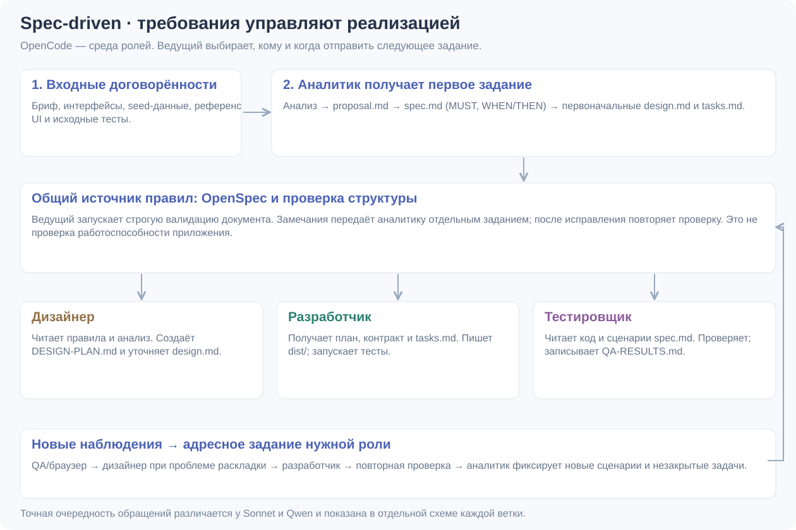
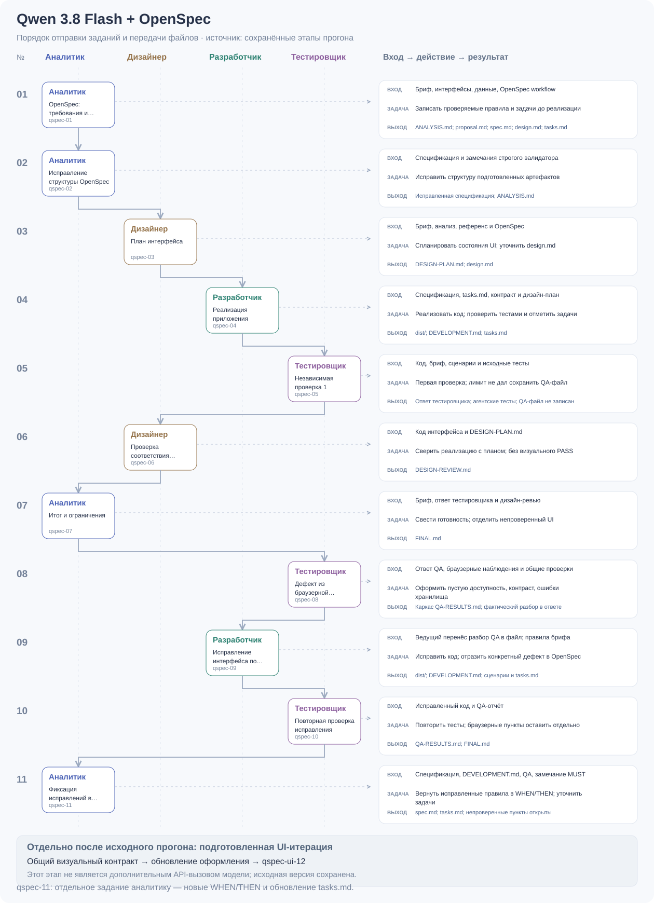
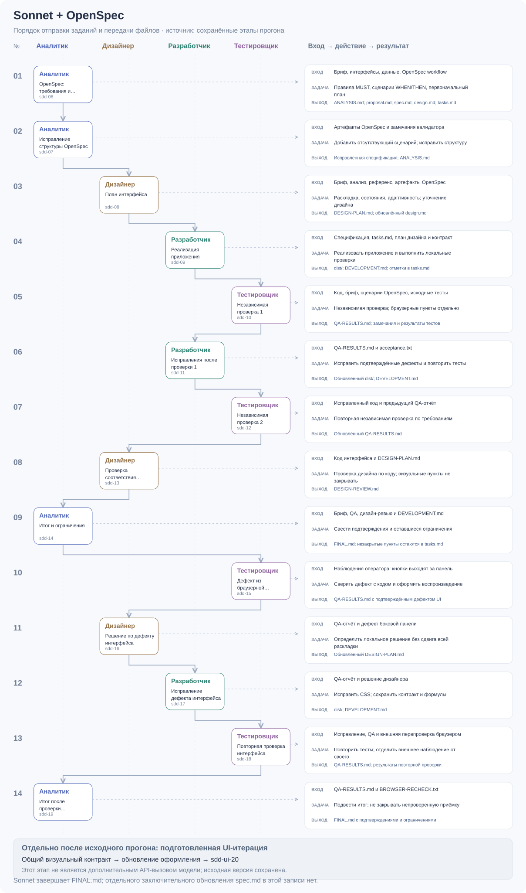
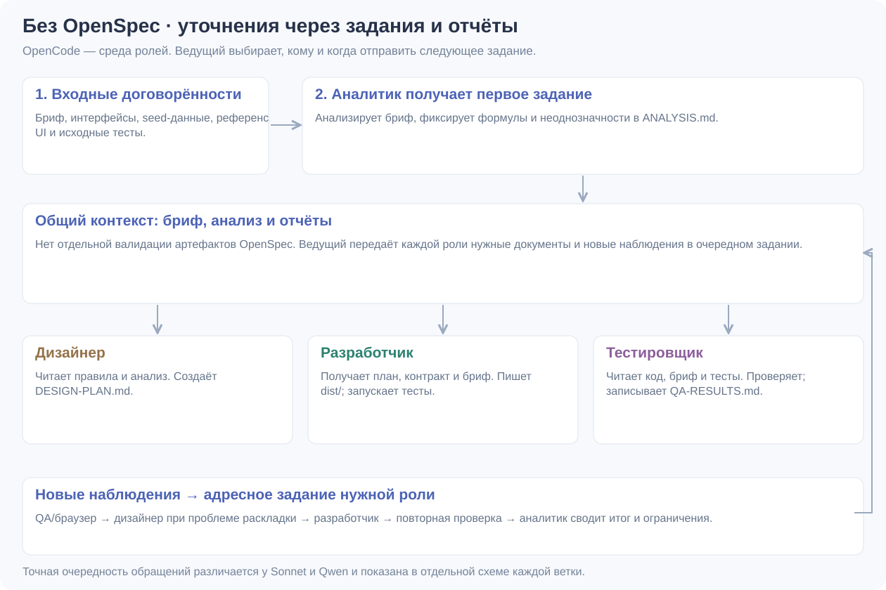
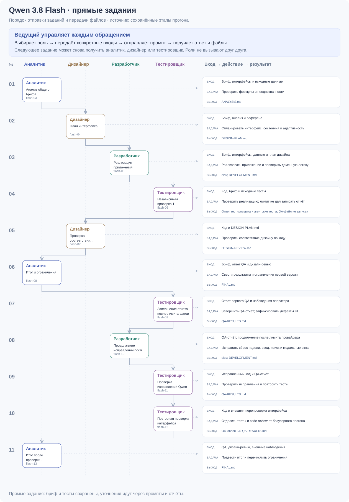
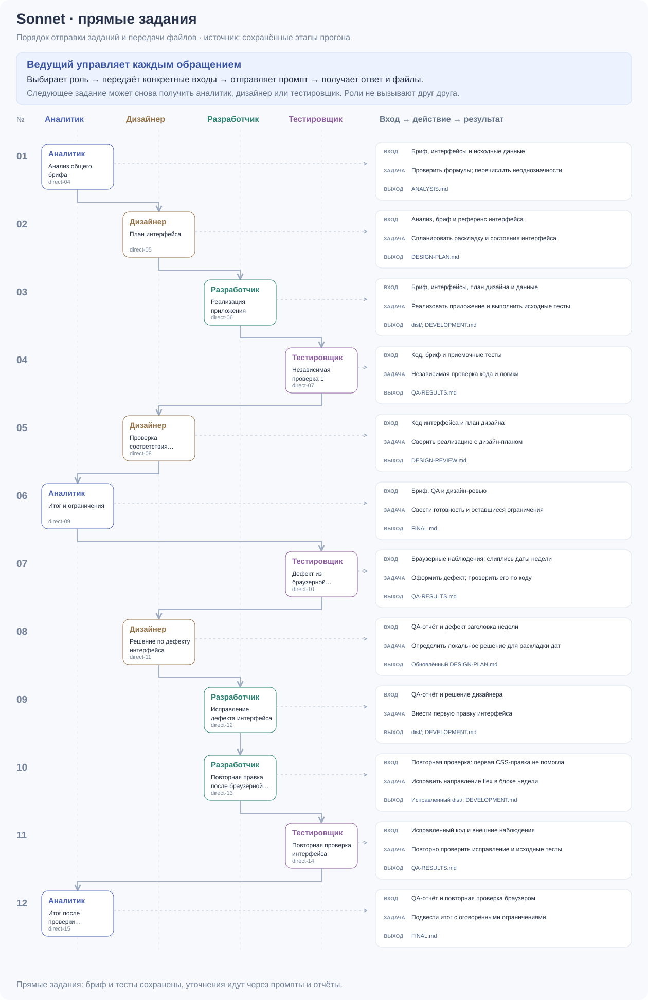

# Задания ролям и spec-driven

Схема читается сверху вниз: одна строка — одно обращение ведущего к выбранной роли. Номер не обозначает общий цикл четырёх агентов. Ведущий выбирает следующую роль после ответа и передаёт ей нужные файлы или новые наблюдения. В записи этот выбор подставляет помощник OpenCode. Самостоятельный вызов других агентов отключён.

Сплошная стрелка соединяет последовательные обращения, пунктир ведёт к входам, задаче и результату роли. Аналитик, дизайнер и тестировщик могут вернуться в работу позже; это отражено отдельными строками.

## Со спецификацией

1. Вход: общий бриф, интерфейсы данных, seed, референс UI и исходные тесты.
2. Аналитик создаёт анализ, proposal.md, spec.md с MUST и WHEN/THEN, первоначальные design.md и tasks.md.
3. Ведущий запускает строгую валидацию документа. Замечания возвращает аналитику отдельным заданием; затем повторяет проверку. Валидация подтверждает структуру спецификации, а не исправность продукта.
4. Дизайнер получает требования, анализ и референс; пишет DESIGN-PLAN.md и уточняет design.md.
5. Разработчик получает спецификацию, контракт, план дизайна и tasks.md; создаёт dist/, проверяет код и отмечает выполненные задачи.
6. Тестировщик получает текущий код, сценарии и тесты. Записывает факты, дефекты и непроверенные пункты. Наблюдения браузера передаёт оператор; они отделены от собственных запусков тестировщика.
7. Ведущий адресует конкретную проблему нужной роли: раскладку — дизайнеру, код — разработчику, повторную проверку — тестировщику. При уточнении поведения правило нужно вернуть в спецификацию.

Это описание подхода; точный порядок обращений каждой записи ниже. Отдельное заключительное обновление spec.md есть у Qwen (qspec-11), а Sonnet заканчивает итогом FINAL.md. Не следует приписывать Sonnet шаг, которого нет в записи.

### Qwen + OpenSpec: 11 обращений

Аналитик → аналитик (замечания валидатора) → дизайнер → разработчик → тестировщик → дизайнер → аналитик → тестировщик (QA и наблюдения оператора) → разработчик → тестировщик → аналитик (фиксация новых сценариев).

На qspec-05 тесты выполнялись, но лимит не позволил сохранить QA-отчёт. На qspec-08 тестировщику отдельно переданы прежний ответ, наблюдения браузера и результаты общих проверок; он сохранил каркас отчёта, а подробный разбор оставил в ответе. Перед qspec-09 ведущий перенёс фактический разбор в QA-файл и отдельно сообщил об этом разработчику. На qspec-11 аналитик фиксирует исправленные правила и оставляет непроверенные задачи открытыми.

### Sonnet + OpenSpec: 14 обращений

Аналитик → аналитик → дизайнер → разработчик → тестировщик → разработчик → тестировщик → дизайнер → аналитик → тестировщик → дизайнер → разработчик → тестировщик → аналитик.

После первой независимой проверки есть отдельные исправление и повторная приёмка. После наблюдения браузером за кнопками боковой панели снова вызывается дизайнер, затем разработчик и тестировщик. Аналитик сводит итоговые подтверждения и ограничения.

## Прямые задания

Здесь тоже существуют бриф, исходные тесты, анализ и дизайн-план. Отличие — нет артефактов OpenSpec и их строгой валидации. Уточнения передаются через очередной промпт и отчёты.

- Qwen: аналитик → дизайнер → разработчик → тестировщик → дизайнер → аналитик → тестировщик (завершение отчёта) → разработчик (продолжение исправлений) → тестировщик → тестировщик → аналитик.
- Sonnet: аналитик → дизайнер → разработчик → тестировщик → дизайнер → аналитик → тестировщик → дизайнер → разработчик → разработчик (первая правка не помогла) → тестировщик → аналитик.

## Источники и обновление схем

Очередность и номера берутся из data/workshop.json. Пояснения входов, действий и результатов — из ui/agent-workflows.js, сопоставленных с сохранёнными промптами и ответами. `npm run diagrams` пересобирает SVG; `npm run check` проверяет, что изображения соответствуют текущим данным. Контрольные суммы исходных чекпоинтов не изменяются.

PDF пересобирается отдельно: после `npm run diagrams` выполнить `python tools/build-workflow-guide.py` на Windows с reportlab и pypdf. Он добавляет актуальные схемы перед исходным PDF, сохраняя старую инструкцию без изменений. Python и эти библиотеки нужны только для авторской пересборки документа; обычный запуск комплекта их не требует.

Подготовленные UI-итерации sdd-ui-20 и qspec-ui-12 показаны отдельно после API-прогонов. Это применение общего визуального контракта; дополнительные API-вызовы этим шагам не приписываются.

Архивный Qwen Coder — более ранний опыт с отдельной историей. Его этапы доступны из карточки архивного результата; современные схемы не подменяют его маршрут.
